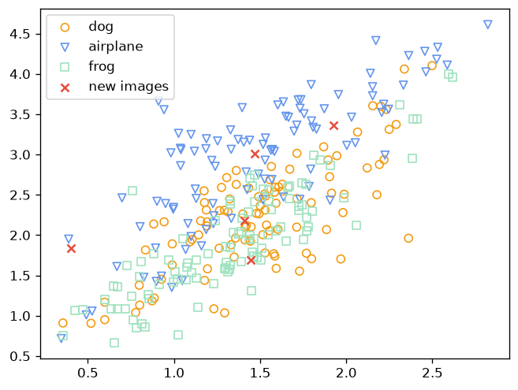
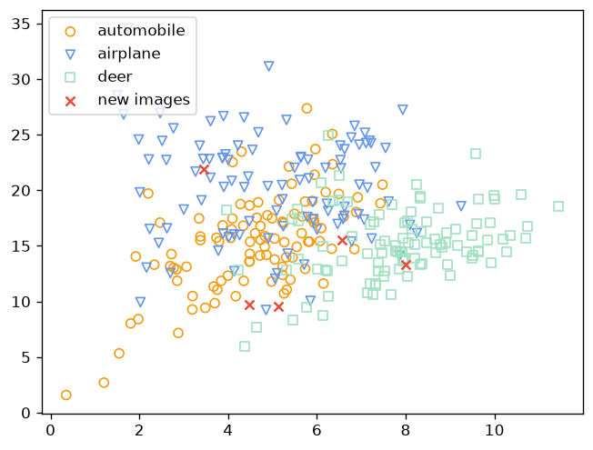

# CIFAR-10 CNN Autoencoders

[](https://github.com/yashbagia1708/cifar10-cnn-autoencoders/actions/workflows/ci.yml)

Two convolutional autoencoders in PyTorch, trained on 300 CIFAR-10 images
(100 from each of three classes), to see what a tiny 2-D bottleneck learns:

- **Unsupervised:** learns only to rebuild its input (MSE reconstruction loss).
- **Supervised:** the same network plus a classifier on the bottleneck,
  trained on reconstruction loss + cross-entropy together.

Both then plot every training image's 2-D embedding, coloured by class, with
five random test images marked as "new images".

Built for a university machine learning unit.

## Architecture

```
32×32×3 image
  └─ encoder: Conv(16) → pool → Conv(8) → pool → Conv(2) → pool   → 4×4×2 code
       ├─ decoder: 3 transposed convs (2 → 8 → 16 → 3)           → 32×32×3 reconstruction
       └─ classifier (supervised only): Linear(32 → 3)
2-D embedding for the plot = the 4×4×2 code averaged over space
```

## Results

1000 full-batch epochs with Adam (lr 0.001), seeded so the run repeats.

| Model | Classes | Final training loss |
|---|---|---|
| Unsupervised | dog, airplane, frog | 0.019 (reconstruction MSE) |
| Supervised | automobile, airplane, deer | 0.039 (reconstruction + classification) |



**Unsupervised:** the classes overlap almost completely. Rebuilding pixels
rewards capturing overall brightness and colour, not what the object is,
so dogs, planes and frogs land in the same diagonal band.



**Supervised:** adding the classification loss pulls the classes apart.
Deer sit on the right and automobiles on the left, with airplanes spread
across the top. Same network, same bottleneck size; only the training signal
changed.

**What this doesn't show:**
- **No held-out accuracy.** Both losses are on the 300 training images, and
  the supervised classifier will be overfitting them. There's no test-set
  evaluation.
- **The "new images" are random test images from any of the 10 classes,**
  not only the three trained on, so where they land isn't meaningful.
- **The class sets differ:** the unsupervised script uses dog, airplane and
  frog, and the supervised one picks three classes at random (seeded).

## Running it

```bash
pip install -r requirements.txt
python unsupervised_autoencoder.py    # downloads CIFAR-10 (170 MB) into data/ on first run
python supervised_autoencoder.py
EPOCHS=5 python supervised_autoencoder.py   # quick check (CI does this)
```

Each script prints the loss every 100 epochs, then saves and shows its
embedding plot. On a laptop CPU, 1000 epochs takes a few minutes.

## Changes since the original submission

- The CIFAR-10 batches that were committed with the original (about 250 MB,
  twice) are gone; torchvision downloads them on first run.
- Runs are seeded, plots are saved to PNG, and `EPOCHS` can be overridden.
- The class list is read from the dataset's labels instead of decoding all
  50,000 training images to find it.
